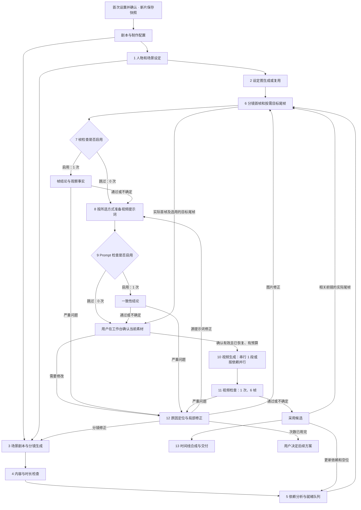

# 节点、产物与调度

AI 维护创作文件、依赖队列、可选检查选择和返工记录；`media_tools.py` 提供单次操作。下面的创作文件由 AI 按当前项目填写，任务、素材、抽帧和视频检查文件由相应脚本命令写入。

## 节点关系

图中的首尾帧含两个不同概念：**目标尾帧**是按需生成的视频输入；**实际尾帧**是已采用完整源视频的最后一帧，不按请求时长提前截取。连续动作使用后者作为下镜参考。

## 每个节点的输入和输出

`P_i` 表示通过内容检查的第 i 个生成片段的动作/对白计划；`F_i` 为实际首帧；`E_i` 为可选目标尾帧；`H_i` 为确认页可以展示的提交正文（在线模式为送往服务端的原文）；`V_i` 为视频候选；`T_i` 为采用候选的实际尾帧。`shots` 每项是一个生成片段，内部可包含事先规划的少量观看镜头，不拆成额外任务。

| 节点 | 输入 | AI 决定 | 脚本执行 | 输出与下一步 |
|---|---|---|---|---|
| 0. 接收与配置 | 用户创意/剧本、时长、画幅、风格、已有素材、预算、交付位置 | 整理故事与已有约束；补齐影响方案的缺失信息 | 新片先 `setup` 确认偏好，再 `init` 保存快照。执行 `doctor`，首次使用此模型时取 `specs` | `script.md`、`settings.json`、`project.json`、模型规格缓存 → 1、3 |
| 1. 人物/场景设定 | 剧本、视觉风格、用户参考 | 确定人物目标、关系和表达方式，以及外观、服饰、场景布局、稳定道具；为说话人物简述声音特点，编写设定图提示词 | 文件读写；用户选择外部文字执笔时调用一次 `text` | `bible.json`：人物/场景 ID、稳定属性、参考路径、图像提示词、人物创作依据与可选声音描述 → 2、3 |
| 2. 人物/场景设定图 | `bible.json`、可用参考图、图像模型规格 | 为各设定选择复用、文生图或编辑 | `submit`、`poll`；图片/编辑共用 2 个名额 | `reference-index.json`：设定 ID → 实际图片、SHA256、任务 ID → 6；已有图可立即供相关镜头使用 |
| 3. 场景剧本与分镜生成 | 剧本/创意、人物/场景文字设定、用户时长约束、模型时长范围 | 在授权范围内先完成有因果与人物回应的场景剧本；按整场安排动作、对白与必要声音，再按叙事作用和切镜理由拆分，确定起止状态、用时、目标尾帧与可选检查 | 在原有创作中保存剧本、场景安排、分镜与源提示词；用户选择外部文字执笔时仍调用一次 `text` | `script.md`、`storyboard.draft.json`、各镜 `prompts/Sxxx-source.txt` → 4；此节点可与 2 重叠 |
| 4. 内容与时长检查 | 分镜草稿、剧本、人物/场景设定、整片时长与单镜规格 | 在原有的一轮内核对冲突因果与结果、人物回应、剧情覆盖、切镜必要性与连续性、动作/对白可容纳性、重复反应及空等；输出修正稿 | 读取模型规格缓存、保存结果；不新增剧本评审、节奏或声音复查节点 | `storyboard.json`、`checks/content.json`、`P_i` → 5；超出已授权范围的剧情或交付规格变更交用户决定 |
| 5. 并行检查/依赖分析 | 通过检查的分镜、参考图状态、采用的视频与尾帧、当前空位 | 区分连续动作、共享外观、独立镜头；选择就绪任务和优先级 | `status` 返回视频/图片的在途数、上限、可用名额 | `dependencies.json`、`queue.json`：就绪/等待镜头及等待原因 → 6、8、10；任务完成时更新队列 |
| 6. 分镜首尾帧生成 | 本镜起止状态、角色/场景图、画幅；连续镜头另有相关前镜 `T_j` | 选择首帧复用/生成/编辑；关键结束状态需要时生成目标尾帧 | `submit`、`poll`，保存文件和哈希；目标尾帧可由当前首帧编辑 | `F_i`、可选 `E_i`、`frames/Sxxx.json` → 7、8、10 |
| 7. 首尾帧 VLM 检查（可选） | `F_i`、可选 `E_i`、分镜起止状态与相关视觉锚点 | 根据分镜中的启用理由检查一次；普通镜头记录 `skipped`；提取可见动作前状态与关键物品关系 | 选择外部 VLM 时用 `text --images` 合并发送首尾帧一次 | `checks/Sxxx-frame.json`：输入哈希、结论、位置证据、观察事实 → 8；严重问题 → 12 |
| 8. 视频提示词处理 | `P_i`、人物声音与表演设定、实际 `F_i`/可选 `E_i`、时长、画幅；启用帧检查时附本轮观察事实 | 按视频提示词写法和 H3 官方格式，把准确对白、情绪变化、动作、声音与切点组织成正文，保留已定起止状态及时间 | 直写或在线路线保存待提交原文。本地路线再调用 `rewrite` 并绑定返回的记录，确认页显示其输出 | `H_i`、分镜的 `video_prompt_file` → 9、10 |
| 9. Prompt 一致性检查（可选） | `P_i`、`H_i`、实际帧、时长、对白和动作顺序 | 根据分镜中的启用理由比较一次，确认主要动作、结束状态、对白与表演安排保持一致；普通镜头记 `skipped` | 保存结论；选择外部模型时 `text` 一次，不增加轮次 | `checks/Sxxx-prompt.json`、采用的最终正文路径 → 10；严重问题 → 12 |
| 9.5. 用户确认素材 | 当前实际请求、图片、对白、时长和最终正文 | 备齐文件并展示工作台；按用户意见修正，等待用户本人确认 | 工作台保存绑定当前内容哈希的 `material-approvals.json`；素材变更后自动失效 | 有效确认 → 10；修改意见 → 对应创作/素材节点；不增加模型检查 |
| 10. 视频生成 | `H_i`、同一组 `F_i`/可选 `E_i`、时长、模型参数、有效用户素材确认、本片提示词路线 | 逐镜串行最多 1 段，按依赖并行默认最多 4 段 | `submit` 在调用云端前检查待规划需求、确认、暂停、预算；保存原文与图片哈希并返回任务 ID；`poll` 查询下载及校验媒体 | `jobs/video_Sxxx_vN.json`、`V_i.mp4`（含模型原生音轨）→ 11 |
| 11. 视频 VLM 检查 | `V_i`、本镜预期动作与状态、实际首帧/选用的目标尾帧 | 当前 AI 或配置 VLM 查看 6 帧一次，给出结论；同轮能听取音轨时记录声音检查 | `inspect` 抽帧、联系表、音轨；`review` 保存结论；采用候选后按依赖需要 `tail` | `inspection/<job>/packet.json`、`reviews/<job>.json`；`pass/uncertain` → 采用候选、更新 5，所需 `T_i` → 后镜 6；`serious` → 12 |
| 12. 提示词重写/局部修正 | 具体问题证据、原分镜、图片、最终提示词、候选、每镜返工记录 | 定位分镜/图片/提示词/视频原因；按本镜选定的 0 或 1 次内容返工额度并选择最小修改范围 | 按 AI 指定节点执行；视频替换请求带 `repair_of`，保存原候选 | `repair-ledger.json`、新版本源文件、受影响依赖 → 对应的 3、6、8；新候选进入其检查节点 1 次；次数用完仍严重则交用户决定 |
| 13. 合成与交付 | 按播放顺序选择的候选、检查报告、原生声音、导出规格；用户要求的字幕 | 确定采用版本、字幕与交付说明 | `assemble` 拼接、核对时长/音轨并输出文件；字幕按已对齐结果制作 | `timeline.json`、`exports/final.mp4`、`exports/assembly.json`、检查/费用/耗时记录 |

视频模型支持的图像字段以本次规格为准。人物/场景约束通过首尾帧和提示词传入；支持额外参考图字段的模型还可接收相应图片。

节点 8 读取 [video-prompts.md](video-prompts.md) 和 [minimax-h3.md](minimax-h3.md)。节点 0 按[首次设置](first-use.md)选定路线。直写为推荐值，本地改写绑定 `rewriter_record`，在线优化显式开启服务端增强。续做读取本片快照。

节点 1、3 的故事与对白写法见 [story-writing.md](story-writing.md)，整场事件安排、切镜和空间连续性见 [scene-planning.md](scene-planning.md)。两者补充原有创作内容，不新建生产节点、调用或检查轮次。节点 0 接收已有剧本或记录创意，节点 3 在授权范围内完成可读剧本；已确定稿只做本次要求的修改。设定图并行后若剧情修改影响外观或场景，先更新相关设定与依赖，不能继续复用失效素材。

## AI 保存的字段

以下文件是 AI 调度的工作记录，辅助脚本读取其命令输入并写任务记录。

| 记录 | 字段 |
|---|---|
| `bible.json` | `characters`、`scenes`；每项含 `id`、`description`、`anchors`、`reference_images`、`image_prompt`；说话人物另有 `speaker_id`、简短 `voice_description`，供各镜提示词复用；人物可用 `dramatic_profile` 记录目标、底线、关系与表达方式；剧情道具放入所属场景或人物 |
| `storyboard.json` | `playback_order`、`total_duration_ms`、`user_duration_constraint`（用户给出的上限或目标，未指定时为空）、`shots`；每镜含 `shot_id`、`characters`、`scene_id`、`start_state`、`action`、`end_state`、`dialogue_audio`、`camera`、`duration_ms`、`timing_reason`、`source_prompt_file`、`first_frame_prompt`、`target_end_frame`（启用、理由、提示词）、`checks`（帧/Prompt 是否启用及理由） |
| `dependencies.json` | 每镜记录 `shot_id`、`relation`、`reason` 和 `requires`。来源类型有设定图、其他镜首帧或采用视频的实际尾帧。可在分镜的 `generation_plan` 中给出判断、置信度与引用。缺少判断或置信度不足时，按播放顺序承接前镜。 |
| `queue.json` | `ready`、`waiting`（等待的产物）、`in_flight`（任务 ID）、`accepted`（镜头 → 候选）、`next_actions`；每次产物/任务状态改变后更新 |
| `frames/Sxxx.json` | `first`、可选 `target_end`；实际路径、SHA256、任务 ID、来源参考；使用实际尾帧时记录来源视频和保留时长 |
| `checks/*.json` | `stage`、`source_hashes`、`enabled`、`reason`、`outcome`（`skipped/pass/uncertain/serious`）、`evidence`、`round`；视频正式报告格式见原子操作文档 |
| `repair-ledger.json` | 每镜 `used`（0 或 1）、`cause_stage`、`evidence`、`changes`、`affected_shots`、替换候选 ID |

`timeline.json` 使用脚本支持的条目：`[{"job_id":"video_S001_v1"},{"job_id":"video_S002_v2"}]`。

新创作可在分镜中增加 `scene_plans`，记录叙事场次的目的、进入/离开状态、关键变化、事件顺序及请求时长合计；每个生成片段可增加 `scene_unit_id`、`beat_ids`、`narrative_purpose`、`cut_reason`、`timing`、`performance`、`internal_shots`，具体见整场规划与视频提示词文档。`source_prompt_file` 保存创作计划，`video_prompt_file` 指向实际提交的 H3 正文。以上创作字段不传给媒体 API；旧记录仍可使用，无需补齐或重做候选。

新分镜的 `dialogue_audio` 可用对象保存：`dialogue` 数组含 `speaker_id`、`text`、`delivery`，并记录预计的 `speech_start_ms`、`speech_end_ms`；`tail_margin_ms` 保存最后一句后的余量，通常为 800–1000 毫秒。以上是生成前的自然语速估计，不是转写或对齐结果。`ambience` 描述持续环境声，`sound_effects` 数组含声音与触发动作，`music` 未安排时为空。无对白镜头使用空 `dialogue` 数组。旧项目的文字格式继续可读；无需为此迁移或重做旧候选。

## 检查次数与抽样方法

| 检查 | 触发 | 一次覆盖的材料 | 默认次数 |
|---|---|---|---|
| 内容与时长 | 新分镜版本 | 故事因果与结果、人物回应、场景/事件覆盖、切镜与连续性、动作/对白重叠、重复反应与空等、单镜及整片时长 | 每版 1 次，修正并输出接受稿 |
| 首尾帧 VLM | AI 标记关键物品接触/状态变化、关键目标结束状态，或素材存在明确冲突 | 同镜首帧与选用的目标尾帧合并 | 普通镜头 0；启用后每组候选 1 |
| Prompt 一致性 | AI 标记对白/动作顺序要求高，或帧观察与源描述有冲突 | 定稿计划、最终提示词与相关实际帧 | 普通镜头 0；启用后每份候选 1 |
| 视频 VLM | 每个新视频候选下载完成 | 6 张带时间戳采样、本镜要求及起止参考；可用时同轮听音轨 | 每候选 1 |
| 技术校验 | 启动、新请求、下载、合成 | 工具/规格、输入、媒体、时间线各自的对应字段 | 每次对应操作 1；规格与已有产物按输入缓存复用 |

视频采样按**完整源视频的解码帧序号均匀选取**，包括第一帧和实际最后一帧。共有 N 帧时，`k = min(6, N)`，选取 `round(j × (N−1)/(k−1))`，`j = 0…k−1`；单帧片段取第 0 帧。每张图标注实际解码时间，最长边 512 px。固定帧率下，6 帧间隔约为 `(实际视频时长 − 一帧时长) / 5`：5 秒镜头约 1 秒一张，10 秒镜头约 2 秒一张。原生音轨完整提取，不按请求时长截断。仍然每候选一轮、默认共 6 帧；旧候选复用已有采样和结论，不为恢复片尾追加检查。

检查输出处理：

- `pass`：继续，保存观察结论。
- `uncertain` 或轻微瑕疵：继续，保存采样未覆盖的关键过程或瑕疵；本候选追加检查 0 次、内容重生成 0 次。
- `serious`：存在可定位的身份/场景改变、主要动作缺失、关键物品或结束状态错误；听过音轨时还可包含关键对白错误。记录图片位置或视频时间点、预期、实际观察和最小修正方向，进入节点 12。

每镜的帧、Prompt、视频内容修正共享本片选定的返工额度，首次建议 1 次，也可选 0 次。首次分镜规划中的文字修正计入节点 4；已产出候选后的内容返工计入 `repair-ledger.json`。AI 维护跨节点共享次数，脚本另执行视频候选 `repair_of` 上限。替换产物在其已启用检查节点各检查 1 次；相同输入与候选哈希直接复用结论。前镜被替换时，AI 按保存的哈希标记受影响的下游素材并重排依赖；超出既定返工/预算时提交具体影响供用户决定。

## 并行队列

- 串行时视频槽位为 1，后镜首帧逐一使用播放顺序中前镜的实际尾帧。按依赖并行时视频槽位默认 4 个。文生图与图像编辑共用 2 个槽位，媒体总计 6 个。选本地改写时适配器一次处理一项。
- 同步提交请求只占短暂调度时间，返回任务 ID 后云端继续生成。AI 随即推进其他就绪操作；每次查询、下载、检查结束后更新可用槽位。
- 同时满足本镜参考、实际帧、最终提示词、检查条件与当前用户素材确认时，将视频放入就绪队列。待规划输入须先应用。优先安排能解锁更多后继镜头的就绪任务；同等条件按播放顺序。素材确认操作和输入交接见 [material-review.md](material-review.md)。
- 有实际尾帧依赖的镜头等待其来源候选检查结束。按依赖并行模式中，只共享人物/场景外观的镜头在公共参考完成后即可并行。回到某场景时可以依赖更早的相关镜头。
- 任一名额释放后立即补入就绪任务。播放顺序始终由 `timeline.json` 决定。

| 分镜中的情况 | 生成时使用的实际素材 |
|---|---|
| 上一镜把卡压在文件下，下一镜换成反打，另一个人从文件下抽卡 | 下一镜等待放卡镜头。取该镜被采用视频的完整末帧，加上同一办公室的空场图和本镜人物图，编辑出反打首帧。新机位仍须呈现同一张桌子、文件和卡的相对位置。 |
| 中间插入走廊空镜，随后回办公室拿卡 | 回办公室时可以指向更早的放卡镜头。记录来源镜头编号、承接的状态和需要的实际图片。 |
| 另一天在同一办公室的独立谈话 | 逐镜记录时间和状态已重置的依据。空间与定妆图就绪即可制作该镜。 |
| 漏写依赖、无法判断道具或人物位置是否承接 | 首镜从设定图起步，其余镜头保守等待播放顺序中的前镜。 |

每镜把实际用于编辑首帧的图片与来源写入 `frames/<分镜ID>.json` 的 `first.sources`。采用的视频换版后，沿这条记录重新判断依赖它的镜头。目标尾帧用于指导本镜结束状态，下游使用采用候选的实际末帧。

例如 `S1 → S2 → S3` 延续同一动作，而 `S4/S5/S6` 起始状态独立：先让 `S1、S4、S5、S6` 的视频同时在途；采用 `S1` 后提取其实际尾帧，准备 `S2`，条件齐备且有名额即提交。期间图片槽位继续准备其他镜头素材。

## 紧凑的时长规划（节点 3–4）

对白字数、4.1 字/秒基准、停顿、动作重叠与最短合法时长的完整算法见 [scene-planning.md](scene-planning.md)。每片段保存 `timing_reason`，将具体开口/结束时刻和句尾余量写进最终正文。普通直接对白尽早开始；情绪通过说话和动作中的变化呈现，不先添加长凝视、吸气或无意义慢推。短反应合并，必要时使用有理由的内部切镜；内容太密时才在完整句子或动作边界拆为独立请求。

节点 4 原有的一轮内容/时长检查，同时核对因果、表演回应、动作容纳、重复反应、停顿和句尾余量。片长“以内”是上限，不是填满配额。`storyboard.user_duration_constraint` 保留原约束，`total_duration_ms` 与 `production.target_duration_ms` 保存各片段请求时长之和；用户上限另写入 `production.max_duration_ms`，例如 5 分钟为 300000。参考已有素材的实际余长预留整片空间，没有样本时按约 10% 预估并记录不确定性。超出上限则精简内容与重排，不裁掉句尾。

`duration_ms` 是提示词与视频生成共同采用的**请求时长**；内容采样、实际尾帧和合成采用**完整源素材**。例如请求 6 秒、实际视频为 6.583 秒时，保留后者及全部原生音轨。候选完成后不能通过修改时间线时长压缩内容；节奏在生成前通过合并、合理切分和动作/对白重叠实现。成片报告分别记录请求时长和实际时长。

## 台词与音效：直接使用原生声音

AI 在剧本/分镜阶段写好对白原文，给出说话人及简短语气；根据动作安排必要的环境声和音效。用户给出原文时保留其措辞；用户只给创意时，由 AI 创作适合时长的自然短句。无对白有助于表达时可以保留无对白镜头，不必让每镜都说话。

当前 AI 按 H3 官方格式，把声音计划、画面动作和情感表演直接写进最终提示词，由视频模型一次生成音画。说话人身份、稳定编号与语气位于台词标签之外，原文逐字放入 `<d>[Chinese] 台词原文</d>`，不丢词、换人或重复对白；同步音效贴合动作，底声与配乐使用相应字段，具体模板见 H3 文档。

每份最终提示词明确预计说话时段、句尾余量和有原因的表演变化。各镜复用人物的稳定声音描述，但文字约束不承诺跨请求音色完全相同；首尾帧依赖仍只传递视觉状态。

本版直接使用模型原生音轨，不增加独立 TTS、音效生成、ASR 对词、音色或口型检查，不因有对白自动开启额外 Prompt 检查。现有检查表、按需节点和次数保持不变；已有同轮检查能听音时如实记录，不能听时保留 `audio_checked: false`，不追加轮次。

## 合成与交付

合成完整保留模型原生音画，不按请求时长使用 `trim/atrim`、`-t`、`-frames:v` 或 `-shortest` 截短成片，不加速、不叠压相邻台词。若原生声音比画面长，仅延续该镜实际最后一帧，待声音结束后接下一镜。此规则用于成片，提取单张尾帧仍可限制为一帧。原生音画源缺音轨时报告素材问题，不用配音或静音替代。

使用 `tail` 返回的完整尾帧路径建立新依赖。旧的提前截取尾帧及下游哈希保持不变；旧候选重合成时复用已有检查记录，在报告中说明新增保留片尾未额外检查，不自动补检查或重生成。完整保留音轨只消除合成截断，不保证模型本身已生成完整对白。

`production.max_duration_ms` 同时约束完整源素材合计和实际导出长度；超出时保留素材并返回调整分镜/台词的说明，不覆盖原成片、不裁音轨。按需字幕使用实际音频的转写/对齐结果，相关文件随成片交付。最终成片仍执行原有的一次技术检查，复用各镜内容结论，不增加声音检查。

总耗时使用项目开始与结束的墙钟时间；阶段耗时、检查耗时、任务数、返工数、媒体积分及文本/视觉调用量分别汇总。比较速度时列出实测条件和墙钟时间。
