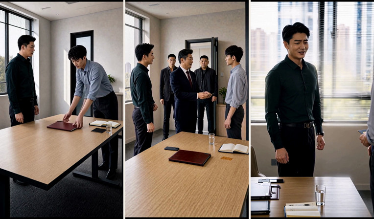
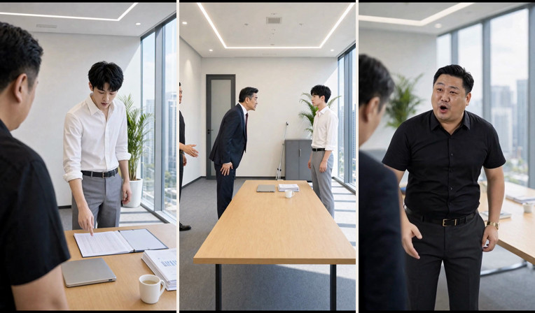

# Story Video Skill · 从剧本到成片

把一份剧本交给 Codex 或 DeepSeek Harness，告诉它片长和画幅，就能做出一部带对白、环境声和动作音效的 MP4。AI 会拆分镜、准备人物和场景参考图、写每一镜的表演和台词，再调用视频模型生成和合成。你在工作台看实际素材、提修改意见、确认满意的镜头，每部片的预算由你决定。

装好后，在项目对话里用一句话就能交代这次制作。

> 用 `produce-story-video` 把 `examples/intern-black-card/script.md` 拍成一部 90 秒左右的竖屏短剧。保留身份揭晓的反转，用普通话对白和现场音效。

把示例文件换成自己的剧本即可。只有故事梗概时，也可以让 AI 先写剧本。[查看这份输入剧本](examples/intern-black-card/script.md)

## 看成片 · 《实习生的黑卡》

一名实习生被经理当众刁难。集团高层走进办公室，却径直越过经理，向实习生鞠躬。下面两版从同一份故事原稿出发，分别由 **Codex** 和 **DeepSeek Harness** 编排制作，视频都由 **MiniMax-H3** 生成。点下方播放器就能观看完整剧情和片尾，点扬声器图标可以听到对白和音效。

| | Codex · 逐镜串行 | DeepSeek Harness · 按依赖并行 |
|---|---|---|
| 在线播放 | https://github.com/user-attachments/assets/d23312c5-bbfd-423f-ae70-8cb922236bb5 | https://github.com/user-attachments/assets/4bca2fe4-20d7-45a6-a3c3-8ce7d5263c1a |
| 成片选帧 | [](https://github.com/mooncity0126/story-video-skill/releases/download/story-workflow-2026-11-21/intern-black-card-codex-serial.mp4) | [](https://github.com/mooncity0126/story-video-skill/releases/download/story-workflow-2026-11-21/intern-black-card-deepseek-parallel.mp4) |
| 下载高清原片 | [下载 MP4 · 1 分 32 秒](https://github.com/mooncity0126/story-video-skill/releases/download/story-workflow-2026-11-21/intern-black-card-codex-serial.mp4) | [下载 MP4 · 1 分 38 秒](https://github.com/mooncity0126/story-video-skill/releases/download/story-workflow-2026-11-21/intern-black-card-deepseek-parallel.mp4) |
| 这一版怎么拍 | 从第二段起，后面九段都等前一段完成，用实际尾帧接着拍。同时在途的视频最多 1 段。 | 十段都规划了独立的起始画面，共用人物定妆照和办公室参考图。同时在途的视频最多 4 段。 |
| 可以留意 | 约 0:25，杯底压住黑卡的一角。到 1:04 左右，黑卡从桌上回到林凡手里。 | 约 0:24，经理伸手推林凡。到 1:04 左右，张总当面鞠躬，再切到经理听见“林董”的反应。 |
| 本次制作记录 | 10 个生成片段，6,658 积分，从启动到导出约 3 小时 33 分。[定稿剧本](examples/intern-black-card/codex-script.md) | 10 个生成片段，6,704 积分，从启动到导出约 48 分钟。[定稿剧本](examples/intern-black-card/deepseek-script.md) |

网页预览为 540 × 960，高清原片为 720 × 1280。两版均保留原声音轨，时长包含片尾。两版的定稿和镜头安排各有调整，计时也包含排队、素材返工和等待人工确认。表中数字只描述这两次制作。Codex 和 DeepSeek Harness 都可以选择串行或按依赖并行。

## 这套流程解决了什么

- **镜头跟着对白走。** 先写清谁想要什么、对方怎么回应，再决定在哪儿切镜。普通话对白按 H3 约每秒 4.1 个实读汉字估时，补上停顿，最后一句再留 0.8–1 秒。合成时保留完整原生音轨，避免把最后几个字剪掉。
- **人物的情绪有动作可拍。** 提示词写清哪句话触发反应、说话人把重音放在哪里、听的人做了什么。比如《第二个名字》里，陈野问“片尾怎么只有你？”，许念把手从鼠标上拿开，观众就能看出她心虚。
- **连续的戏能接着上一镜拍。** 递卡、换座位、移动道具时，后镜能继承已采用视频的真实最后一帧。选逐镜串行后，程序会强制等待这个依赖。选按依赖并行时，参考图已经就绪的独立场景可以同时制作。
- **花视频积分前能看素材。** 工作台放在本机。首帧、选用的目标尾帧、对白、片长和要提交的提示词可以放在一起看。你可以要求改一镜、暂停或继续，已生成的候选和任务记录会保留。
- **第一次选好，后续新片直接沿用。** 可以选择视频 API、调度方式，以及 AI 直写、本地改写或服务端优化。三种提示词方式每次选一种，界面会说明对等待时间、对白可控性和数据去向的影响。每部影片保存自己的配置。[首次设置说明](.agents/skills/produce-story-video/references/first-use.md)

这轮制作留下了 **4 个故事、7 版成片**。《关门以后》用 32 段拍成 3 分 01 秒。《第二个名字》保留了共同署名的争执，从 23 段、2 分 47 秒收紧到 13 段、1 分 41 秒。重制后的观片反馈中，人物情绪和对白完整度改善较明显，个别画面仍有闪烁，女主在部分镜头的脸也有变化。[《第二个名字》初版](https://github.com/mooncity0126/story-video-skill/releases/download/story-workflow-2026-11-21/second-name-original.mp4) · [紧凑重制版](https://github.com/mooncity0126/story-video-skill/releases/download/story-workflow-2026-11-21/second-name-remake.mp4)

## 安装和使用

已有运行环境时，可下载[独立 skill 包](https://github.com/mooncity0126/story-video-skill/releases/download/story-workflow-2026-11-21/produce-story-video.zip)，解压到原项目的 `.agents/skills/` 目录。首次安装请使用下面的完整仓库。

当前安装脚本适配 Windows x64 和 Python 3.12。直写与服务端优化都可以只装基础环境。先克隆或下载本仓库，然后在仓库根目录运行以下命令。

```powershell
py -3.12 scripts/bootstrap.py --component harness
```

1. 在生成的 `config/api-keys.local.json` 填写视频网关的 `X2V_API_KEY`。选择外部文字或视觉服务时再填写相应密钥。密钥保存在本机文件中。
2. 运行下面的命令启动工作台，打开显示的本机地址，在「工作流设置」确认偏好。建议先用逐镜串行、MiniMax-H3 和 AI 直写体验连续剧情。
3. 在 Codex 中打开这个项目，或让 DeepSeek Harness 加载仓库里的 `.agents/skills/produce-story-video` 目录并以仓库为工作目录。把剧本交给它，或先在工作台「新建」里粘贴剧本，再回到对话让 AI 继续制作。
4. 确认这部片的报价和积分上限，在分镜页检查实际素材。已确认且依赖就绪的镜头会进入生成队列。完成后在工作台「成片」播放，文件保存在 `runs/<项目>/exports/final.mp4`。

```powershell
& .\runtime\video-harness\.venv\Scripts\python.exe scripts/workbench.py
```

本机默认地址是 `http://127.0.0.1:8787/`。也可以使用仓库内的 `Start-Workbench.ps1` 和 `Stop-Workbench.ps1`。如需在两个执行端共用外部安装的 skill，可在 `config/skill-location.json` 中填写 `skill_root`，或设置进程变量 `STORY_VIDEO_SKILL_DIR`。项目命令和工作台读取同一位置。

<details>
<summary>可选的本地 Prompt Rewriter、离线安装包与命令行入口</summary>

本地改写需要单独的 CUDA Python 环境和模型权重。将 `Qwen3-VL-8B-Instruct` 和 `MiniMax-H3-Prompt-Rewriter-LoRA-8B` 放入同一个模型目录，再运行下面的安装命令。

```powershell
py -3.12 scripts/bootstrap.py --component rewriter --model-root "D:\Models\Prompt-Rewriter"
```

安装脚本也支持 `--dry-run` 查看计划，或通过 `--ffmpeg-archive <路径>` 使用已下载的官方发行 ZIP。运行配置位于 `config/local-settings.json`，命令行和工作台共享首次设置。

```powershell
& .\runtime\video-harness\.venv\Scripts\python.exe scripts/media.py doctor
& .\runtime\video-harness\.venv\Scripts\python.exe scripts/media.py setup
```

[FFmpeg Windows x64 附件](https://github.com/mooncity0126/story-video-skill/releases/download/runtime-v0.1.0/ffmpeg-9.0.2-essentials-windows-x64.zip) · [历史 v0.1.0 运行依赖包](story-video-runtime-v0.1.0.zip)

</details>

## 代码、工作流与来源

[Skill 入口](.agents/skills/produce-story-video/SKILL.md) · [逐步工作流](.agents/skills/produce-story-video/references/workflow.md) · [提示词写法](.agents/skills/produce-story-video/references/video-prompts.md) · [工作台源码](workbench/) · [验证记录](VALIDATION.md) · [本次发布与完整样片](https://github.com/mooncity0126/story-video-skill/releases/tag/story-workflow-2026-11-21)

项目在 LightX2V 的 video-harness 基础上制作，吸收了 `zenstory-ai/drama-skills` 的短剧写作、分镜和视频提示词方法，并适配 MiniMax-H3 的原生音画生成。[方法来源](.agents/skills/produce-story-video/references/provenance.md) · [第三方说明和许可证](THIRD_PARTY_NOTICES.md)
